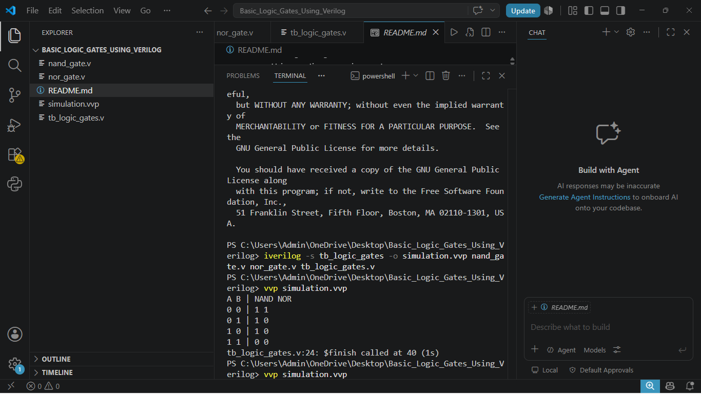

# Basic Logic Gates Using Verilog

## 1. Project Description

This project implements NAND and NOR logic gates using Verilog HDL.

The gates are designed using Dataflow Modeling with the `assign` statement.

The project demonstrates basic digital logic design and functional verification using a Verilog testbench.

## 2. NAND Gate

### Boolean Expression

Y = ~(A & B)

### Truth Table

| A | B | NAND Output |
|---|---|-------------|
| 0 | 0 | 1 |
| 0 | 1 | 1 |
| 1 | 0 | 1 |
| 1 | 1 | 0 |

### Verilog Code (nand_gate.v)

```verilog
module nand_gate(
    input A,
    input B,
    output Y
);

assign Y = ~(A & B);

endmodule
```

## 3. NOR Gate

### Boolean Expression

Y = ~(A | B)

### Truth Table

| A | B | NOR Output |
|---|---|------------|
| 0 | 0 | 1 |
| 0 | 1 | 0 |
| 1 | 0 | 0 |
| 1 | 1 | 0 |

### Verilog Code (nor_gate.v)

```verilog
module nor_gate(
    input A,
    input B,
    output Y
);

assign Y = ~(A | B);

endmodule
```

## 4. Testbench

The testbench applies all four possible binary input combinations to both gates and displays the outputs.

File: `tb_logic_gates.v`

```verilog
module tb_logic_gates;

reg A, B;
wire Y_nand, Y_nor;

nand_gate dut1(A, B, Y_nand);
nor_gate dut2(A, B, Y_nor);

initial begin
    $display("A B | NAND NOR");

    A=0; B=0; #10;
    $display("%b %b | %b %b", A,B,Y_nand,Y_nor);

    A=0; B=1; #10;
    $display("%b %b | %b %b", A,B,Y_nand,Y_nor);

    A=1; B=0; #10;
    $display("%b %b | %b %b", A,B,Y_nand,Y_nor);

    A=1; B=1; #10;
    $display("%b %b | %b %b", A,B,Y_nand,Y_nor);

    $finish;
end

endmodule
```

## 5. Simulation Results

Expected simulation output:

```text
A B | NAND NOR
0 0 | 1 1
0 1 | 1 0
1 0 | 1 0
1 1 | 0 0
```


### Actual Simulation Output



## 6. Tools Used

- Verilog HDL
- Visual Studio Code
- Icarus Verilog (iverilog and vvp)
- GitHub (for project portfolio)

## 7. How to Run

Compile the project:

```bash
iverilog -s tb_logic_gates -o simulation.vvp nand_gate.v nor_gate.v tb_logic_gates.v
```

Run the simulation:

```bash
vvp simulation.vvp
```

## 8. Learning Outcomes

- Understanding NAND and NOR logic gates
- Writing Verilog modules
- Using continuous assignments
- Creating a basic testbench
- Simulating combinational logic circuits

## 9. Conclusion

This project demonstrates the implementation and simulation of basic digital logic gates using Verilog HDL.

It provides a foundation for RTL Design and Design Verification.
